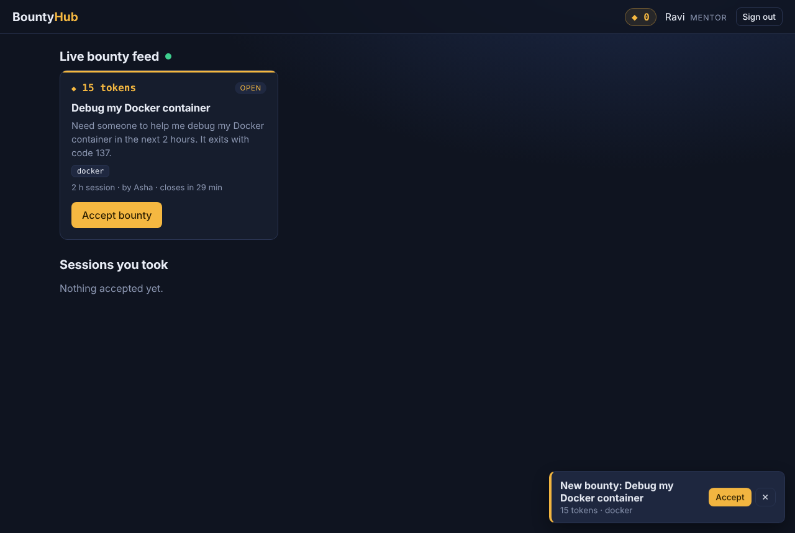
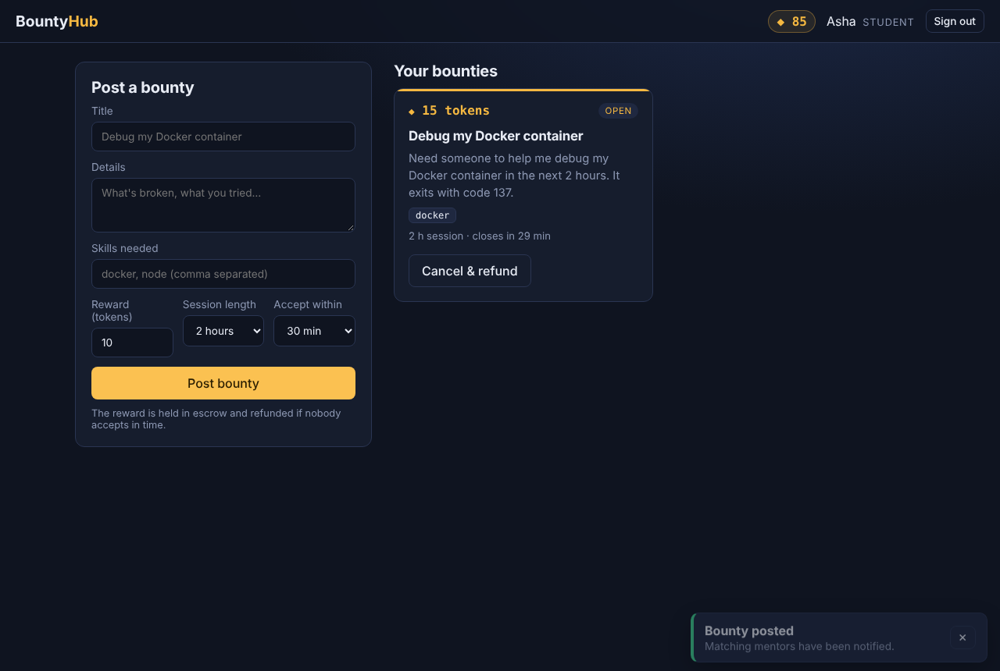
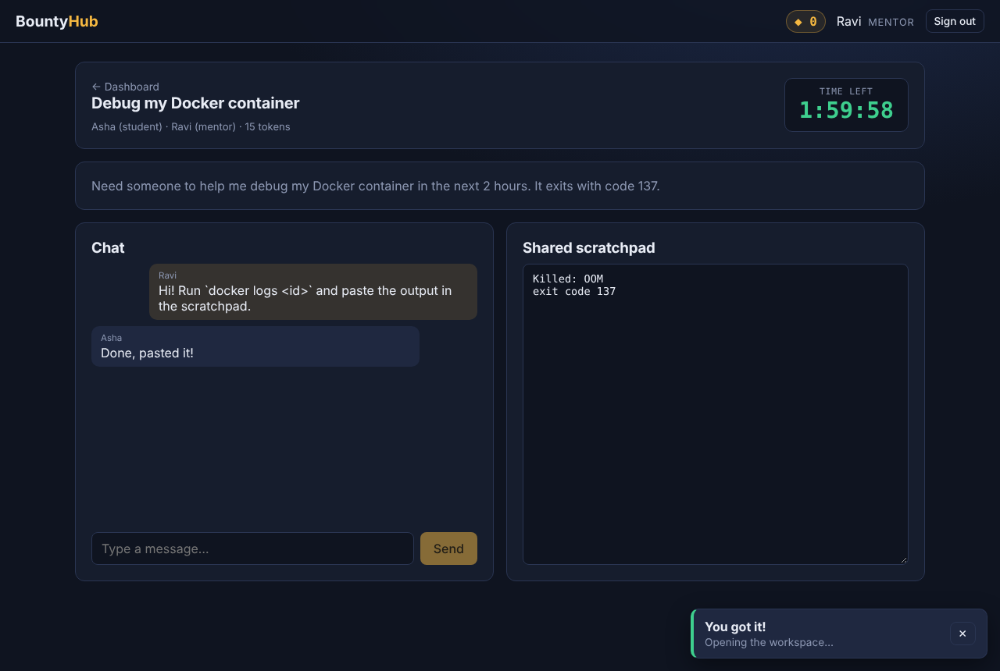

# BountyHub: Real-time Micro-Gig Bounties for Students

> *"Need someone to help me debug my Docker container in the next 2 hours. Reward: 15 Tokens."*

BountyHub borrows the **pay-per-request** model for peer help. A student posts a **bounty** (a micro-gig with a token reward). **Eligible mentors get a real-time push over WebSockets**, and the **first mentor to accept opens a secure, time-locked workspace room** where the two of them chat and share a scratchpad until the clock runs out.

**Stack:** MongoDB (Docker) · Express 5 · React 19 (Vite) · Node.js · Socket.IO · JWT · Jest / Vitest / Supertest / Playwright



---

## Features

| | |
|---|---|
| 🎯 **Bounties** | Title, details, skill tags, reward, session length, accept window |
| 💰 **Token escrow** | Reward is held when posted; paid to the mentor on completion; refunded on cancel or expiry. Students start with 100 tokens |
| ⚡ **Real-time push** | Only mentors whose skills match get `bounty:new`, instantly, with one-click **Accept** |
| 🏁 **First mentor wins** | Atomic MongoDB compare-and-set: two simultaneous accepts give one 200 and one 409 |
| 🔒 **Secure, time-locked room** | Only the two participants can join; live chat + shared scratchpad; countdown; read-only once time is up or the bounty is completed |
| ⏱ **Auto-expiry** | Un-accepted bounties expire after the accept window and are refunded automatically |
| 🧪 **TDD** | 74 server tests + 20 client tests + browser E2E; one repository contract suite runs against both in-memory and MongoDB adapters |

## Screenshots

| Student posts | Time-locked room |
|---|---|
|  |  |

## Quick start

> Full step-by-step instructions, troubleshooting and the no-Docker option are in **[RUNNING_LOCALLY.md](RUNNING_LOCALLY.md)**.

```bash
# 1. MongoDB in Docker
docker compose up -d mongo

# 2. API (http://localhost:5000)
cd server
cp .env.example .env
npm install
npm run seed        # optional demo accounts (password: password123)
npm run dev

# 3. Client (http://localhost:5173), in a second terminal
cd client
npm install
npm run dev
```

Open **two browser windows** (one normal, one incognito). Log in as `student@bountyhub.dev` in one and `mentor@bountyhub.dev` in the other, post a bounty with the tag `docker`, and watch the mentor get pinged.

## Running the tests

```bash
cd server && npm test            # unit + REST + WebSocket integration (no DB needed)
cd client && npm test            # React components & utilities

# repository contract against the real MongoDB container
docker compose up -d mongo
cd server && MONGO_URI_TEST=mongodb://localhost:27017/bountyhub_test npm run test:mongo
```

## Documentation

| Doc | Contents |
|---|---|
| [1. System Architecture](docs/01-system-architecture.md) | Tiers, ports & adapters, request paths, concurrency, security, deployment |
| [2. High-Level Design](docs/02-high-level-design.md) | Requirements, components, bounty state machine, sequence diagrams, socket event catalogue |
| [3. Low-Level Design](docs/03-low-level-design.md) | Module layout, class diagram, service pseudocode, repository contract, error mapping |
| [4. Use Cases](docs/04-use-cases.md) | Use case diagram + 10 detailed use cases |
| [5. Database Design](docs/05-database-design.md) | ER diagram, collections, indexes, atomic operations |
| [6. API Reference](docs/06-api-reference.md) | Every REST endpoint + curl walkthrough |
| [7. Testing Strategy](docs/07-testing-strategy.md) | TDD approach, test pyramid, doubles, results |

Diagram sources (Mermaid `.mmd` / SVG) live in `docs/diagrams/` next to the rendered PNGs.

## Project structure

```
bountyhub/
├── docker-compose.yml     # MongoDB 7
├── server/                # Express + Socket.IO API
│   ├── src/
│   │   ├── domain/        # constants, errors, skill matching
│   │   ├── services/      # auth, bounty, room (business rules)
│   │   ├── repositories/  # mongo/ (Mongoose) and memory/ adapters
│   │   ├── routes/        # REST handlers
│   │   ├── realtime/      # Socket.IO gateway + notifier
│   │   └── server.js
│   └── tests/             # contract, unit, integration, mongo
├── client/                # React + Vite SPA
│   └── src/{api,context,components,pages,lib,hooks}
├── e2e/                   # Playwright smoke test (optional)
└── docs/                  # architecture, HLD, LLD, use cases, DB, API, testing
```

## How the key pieces work

**First mentor wins.** Accepting runs one guarded update:
`findOneAndUpdate({ _id, status: 'open', expiresAt: { $gt: now } }, { $set: { status: 'accepted', acceptedBy } })`.
MongoDB applies it atomically, so only one request can match. The loser gets `409 Conflict` and every mentor's card disappears through `bounty:taken`.

**Time lock.** Each room stores `expiresAt = acceptedAt + sessionMinutes`. Every write checks `status === 'active' && now < expiresAt`, otherwise it returns `423 Locked`. The client counts down from the same timestamp and disables input at zero.

**Eligibility.** Tags and skills are normalised to lower case. A mentor is eligible if they share at least one skill with the bounty (or the bounty has no tags). Only eligible mentors are pushed, and the server re-checks eligibility on accept.

## Author

Built by **Divyanshi**.
