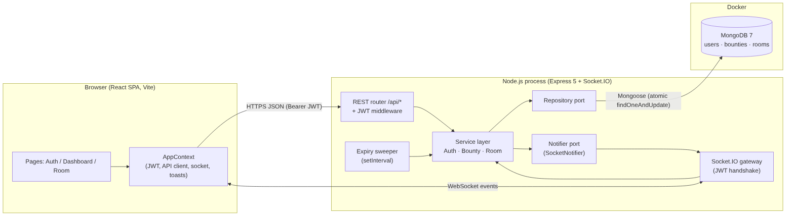

# 1. System Architecture

BountyHub is a **MERN** application (MongoDB, Express, React, Node.js) with a real-time layer on **Socket.IO (WebSockets)**. Students post paid micro-gigs ("bounties"), eligible mentors get a live push, and the first mentor to accept opens a **time-locked workspace room**.



## 1.1 Building blocks

| Tier | Technology | Responsibility |
|---|---|---|
| Client | React 19 + Vite, React Router, `socket.io-client` | UI, session (JWT in `localStorage`), live notifications, room countdown |
| API | Node.js 20+, Express 5 | REST endpoints under `/api`, JWT auth middleware, validation, error mapping |
| Realtime | Socket.IO 4 (WebSocket transport, polling fallback) | Push `bounty:*` events to users, room chat & shared notes |
| Domain | Plain JS service modules | Business rules: escrow, eligibility, first-wins claim, time lock, expiry |
| Persistence | MongoDB 7 (Docker) via Mongoose 9 | Users, bounties, rooms (messages embedded) |
| Scheduler | `setInterval` sweeper in the API process | Expires un-accepted bounties and refunds escrow |

## 1.2 Architectural style: Ports & Adapters (hexagonal)

The service layer never imports Express, Socket.IO or Mongoose. It depends on four small **ports** that are injected at start-up:

| Port | Production adapter | Test adapter |
|---|---|---|
| `UserRepository`, `BountyRepository`, `RoomRepository` | `repositories/mongo` (Mongoose) | `repositories/memory` |
| `Notifier` | `realtime/notifier.js` (Socket.IO rooms) | recording double in `tests/helpers` |
| `Clock` | `{ now: () => new Date() }` | controllable fake clock |

This is what makes the TDD approach practical. Business rules such as "the accept window closes after 30 minutes" or "the room locks after 2 hours" are tested in milliseconds by moving a fake clock, and **both repository adapters must pass the same contract test suite** (`tests/contract/repositories.contract.js`).

## 1.3 Request paths

1. **REST** (`fetch` → `/api/*`): register/login, post/accept/complete/cancel bounties, read rooms. Each request carries `Authorization: Bearer <JWT>`.
2. **WebSocket** (`socket.io`): the client connects once after login with `auth: { token }`. The server verifies the JWT in a handshake middleware and joins the socket to:
   - `user:<id>`: personal notifications (works across multiple tabs and devices)
   - `role:mentor`: broadcast that a bounty is gone (taken, cancelled or expired)
   - `room:<id>`: only after `room:join` passes the participant check
3. **Server push**: any service call that changes state emits through the `Notifier`. A bounty accepted over REST still notifies the student over WebSocket.

## 1.4 Concurrency and consistency

"First mentor to accept wins" is enforced **in the database**, not in application memory:

```js
Bounty.findOneAndUpdate(
  { _id, status: 'open', expiresAt: { $gt: now } },   // guard
  { $set: { status: 'accepted', acceptedBy, acceptedAt: now } },
  { returnDocument: 'after' }
)
```

MongoDB applies single-document updates atomically, so when two mentors click at the same instant exactly one update matches. The other gets `null`, which becomes **409 Conflict**. The same guarded-update pattern protects:

- **Token balance**: `{ tokens: { $gte: amount } }` + `$inc` means it can never go negative.
- **Completion and cancellation**: `transition(id, fromStatus, patch)` prevents double payout or a refund after acceptance.

This stays correct even with several API instances behind a load balancer.

## 1.5 Security

- Passwords hashed with **bcrypt** (cost 10 by default).
- Stateless **JWT** (HS256, 7-day default), required on every REST route except auth/health and on the socket handshake.
- Authorisation is checked in the service layer: role checks, poster-only completion and cancellation, participant-only rooms, skill eligibility on accept.
- Input validation and length limits on all user text; JSON body limited to 100 kB.
- CORS restricted to `CORS_ORIGIN`.

## 1.6 Deployment view (local)

```
┌───────────── developer machine ─────────────┐
│  :5173  Vite dev server (React)              │
│         └─ proxies /api and /socket.io  ──┐  │
│  :5000  Node API + Socket.IO  ◄───────────┘  │
│         └─ mongodb://localhost:27017         │
│  :27017 Docker container "bountyhub-mongo"   │
│         (volume mongo-data)                  │
└──────────────────────────────────────────────┘
```

## 1.7 Scaling path (beyond the scope of this project)

- Run several API instances with the **Socket.IO Redis adapter** so `io.to(...)` reaches sockets on any node. Only `realtime/notifier.js` changes.
- Move the expiry sweeper to a single worker, or use a MongoDB TTL index plus change streams.
- Replace Socket.IO with a managed pub/sub service (e.g. Ably) by writing a new `Notifier` adapter; services stay untouched.
- Collaborative editing (CRDT/Yjs) for the scratchpad instead of last-write-wins.
