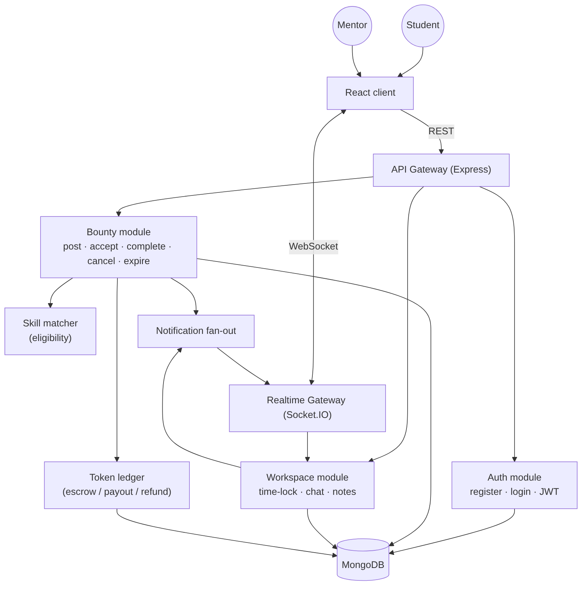
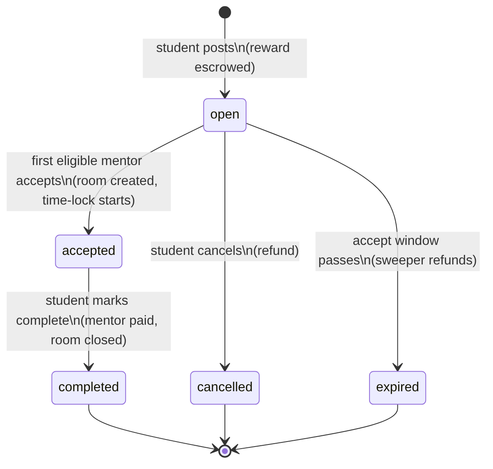
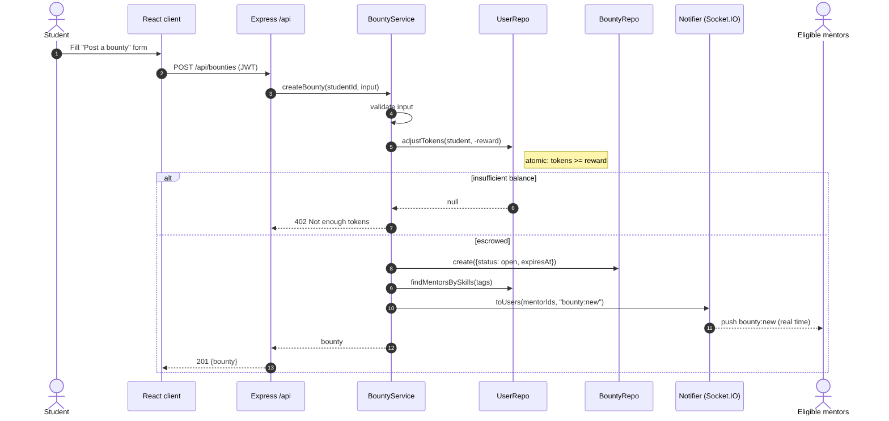
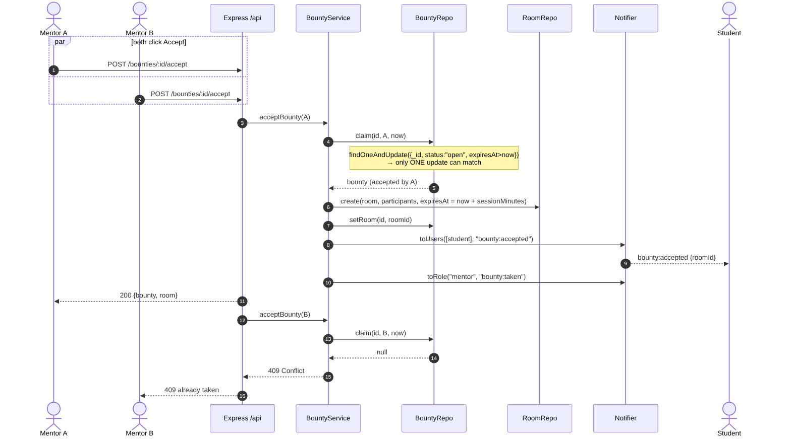
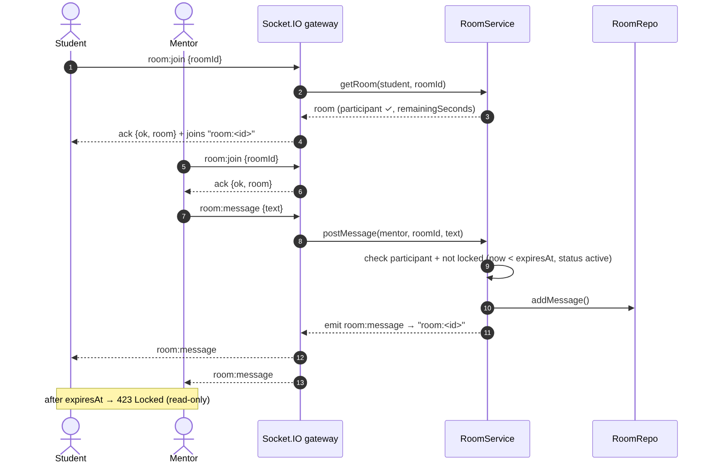

# 2. High-Level Design (HLD)

## 2.1 Problem statement

Students regularly get stuck on time-sensitive technical problems ("my Docker container keeps exiting, demo in 2 hours"). Forums are slow and asynchronous. BountyHub borrows the **pay-per-request** model: the student attaches a token reward to a concrete request, qualified mentors are pinged instantly, and the first to commit gets a private, time-boxed space to solve it.

## 2.2 Goals

| # | Functional requirement |
|---|---|
| F1 | Users register as **student** or **mentor**; mentors declare skills |
| F2 | Students post a bounty: title, details, skill tags, reward (tokens), session length, accept window |
| F3 | The reward is **escrowed** from the student's balance when the bounty is posted |
| F4 | **Eligible mentors** (at least one matching skill, or any mentor when no tags) get a **real-time push** |
| F5 | The **first eligible mentor to accept** wins; everybody else is told it's taken |
| F6 | Acceptance opens a **secure, time-locked workspace** (chat + shared scratchpad) for exactly the two participants |
| F7 | When time runs out the room becomes **read-only** |
| F8 | The student marks the bounty complete → escrow is **paid to the mentor**, room closes |
| F9 | Students can cancel an open bounty (refund); un-accepted bounties **expire** automatically (refund) |

| # | Non-functional requirement |
|---|---|
| N1 | Notification latency under 1 s on a LAN (WebSocket push, no polling) |
| N2 | No double-acceptance and no double-payment under concurrency |
| N3 | Token balances never negative |
| N4 | Test-driven: business rules covered by automated tests that run without external services |
| N5 | One-command local database via Docker |

## 2.3 Component view

| Module | Responsibilities | Key collaborators |
|---|---|---|
| **Auth** | Registration, login, JWT issue/verify, `me` | UserRepository, bcrypt, jsonwebtoken |
| **Bounty** | Post (validate + escrow + fan-out), accept (atomic claim + room), complete (payout), cancel/expire (refund), feeds | User/Bounty/Room repos, Notifier, Clock |
| **Workspace (Room)** | Participant check, time-lock evaluation, chat, notes | RoomRepository, Notifier, Clock |
| **Token ledger** | Escrow (`-reward`), payout (`+reward` to mentor), refund (`+reward` to student) | `UserRepository.adjustTokens` (guarded `$inc`) |
| **Skill matcher** | Normalise tags/skills, decide eligibility | `domain/skills.js` |
| **Notification fan-out** | Address users, roles and rooms | Socket.IO rooms |

## 2.4 Bounty lifecycle

| Transition | Trigger | Side effects |
|---|---|---|
| ∅ → `open` | Student posts | −reward from student; `bounty:new` → eligible mentors |
| `open` → `accepted` | First eligible mentor accepts within window | Room created (`expiresAt = now + sessionMinutes`); `bounty:accepted` → student; `bounty:taken` → mentors |
| `open` → `cancelled` | Poster cancels | +reward refund; `bounty:taken` → mentors |
| `open` → `expired` | Sweeper finds `expiresAt ≤ now` | +reward refund; `bounty:expired` → student; `bounty:taken` → mentors |
| `accepted` → `completed` | Poster marks complete | +reward → mentor; room closed; `room:closed` → room; `bounty:completed` → mentor |

There are two different clocks per bounty:

- **Accept window** (`bounty.expiresAt`): how long mentors have to grab it.
- **Session time lock** (`room.expiresAt`): how long the workspace is writable after acceptance.

## 2.5 Key flows

### Post a bounty → real-time push

### Accept a bounty (race between two mentors)

### Work inside the time-locked room

## 2.6 Real-time event catalogue

| Event | Direction | Audience | Payload |
|---|---|---|---|
| `bounty:new` | server → client | eligible mentors (`user:<id>`) | full bounty + `postedByName` |
| `bounty:taken` | server → client | `role:mentor` | `{ bountyId, by?, reason: accepted\|cancelled\|expired }` |
| `bounty:accepted` | server → client | poster | `{ bountyId, roomId, mentorId, mentorName, title }` |
| `bounty:completed` | server → client | mentor | `{ bountyId, reward, title }` |
| `bounty:expired` | server → client | poster | `{ bountyId, title, refunded }` |
| `room:join` | client → server (ack) | — | `{ roomId }` → `{ ok, room }` |
| `room:leave` | client → server (ack) | — | `{ roomId }` |
| `room:message` | both | `room:<id>` | `{ roomId, text }` / `{ id, sender, text, sentAt, roomId }` |
| `room:notes` | both | `room:<id>` | `{ roomId, notes }` / `{ roomId, notes, by }` |
| `room:closed` | server → client | `room:<id>` | `{ roomId, reason }` |

Every client→server event is **acknowledged** with `{ ok: true, ... }` or `{ ok: false, status, error }`, using the same status codes as REST.

## 2.7 Technology choices

| Decision | Why |
|---|---|
| Socket.IO over raw `ws` | Rooms, acknowledgements, auto-reconnect and polling fallback are built in; a Redis adapter is available for horizontal scale |
| Messages embedded in Room | A session is short and bounded (≤ 8 h); messages are always read with their room; single-document atomic `$push` |
| Tokens as an integer on User | Simple, atomic guarded `$inc`; a ledger collection is a natural next step for audit history |
| JWT (stateless) | Same token authenticates REST and the socket handshake; no session store needed |
| In-memory repository | Lets the full test suite (incl. HTTP + WebSocket end-to-end) run in about 3 s with zero infrastructure |
