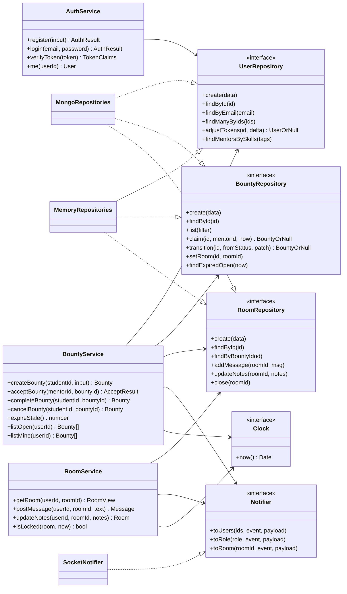

# 3. Low-Level Design (LLD)

## 3.1 Source layout

```
server/
├── src/
│   ├── server.js               # entry: load config, connect Mongo (or memory), listen, start sweeper
│   ├── bootstrap.js            # buildServer({repos, config, clock}) → {app, httpServer, io, services}
│   ├── config/index.js         # env → typed config
│   ├── domain/
│   │   ├── constants.js        # ROLES, BOUNTY_STATUS, ROOM_STATUS, LIMITS
│   │   ├── errors.js           # AppError(status) + helpers, DuplicateKeyError
│   │   └── skills.js           # normalizeTags(), isEligible()
│   ├── services/
│   │   ├── index.js            # createServices({repos, clock, notifier, config})
│   │   ├── authService.js
│   │   ├── bountyService.js
│   │   └── roomService.js
│   ├── repositories/
│   │   ├── memory/index.js     # Map-backed adapter
│   │   └── mongo/{models,index}.js
│   ├── routes/index.js         # thin Express handlers
│   ├── middleware/{auth,errorHandler}.js
│   ├── realtime/{socket,notifier}.js
│   └── scripts/seed.js
└── tests/
    ├── contract/repositories.contract.js   # shared spec for every repo adapter
    ├── helpers/context.js                  # fake clock, recording notifier, wiring
    ├── unit/        # services + memory repos
    ├── integration/ # supertest REST + real Socket.IO clients
    └── mongo/       # contract against real MongoDB (needs MONGO_URI_TEST)

client/src/
├── api/client.js            # fetch wrapper (injectable fetch/token)
├── context/AppContext.jsx   # auth state, API, socket, toast queue
├── hooks/useNow.js          # 1 s ticker for countdowns
├── lib/time.js              # formatDuration, secondsUntil, relativeFromNow, sessionLabel
├── components/              # BountyCard, PostBountyForm, Toasts (+ tests)
└── pages/                   # AuthPage, Dashboard, RoomPage
```

## 3.2 Class / module diagram



## 3.3 Service contracts

### AuthService

| Method | Rules | Errors |
|---|---|---|
| `register({name,email,password,role,skills})` | trims name; lower-cases email; password ≥ 6; role ∈ {student, mentor}; mentors need ≥ 1 skill; skills normalised + de-duplicated; students get `STARTER_TOKENS` (100) | 400 validation, 409 duplicate email |
| `login({email,password})` | bcrypt compare | 401 (same message for unknown email and wrong password) |
| `verifyToken(token)` | returns `{ id, role }` from JWT `sub`/`role` | 401 |
| `me(userId)` | user without `passwordHash` | 401 if user deleted |

### BountyService

```text
createBounty(studentId, input)
  user := users.findById(studentId); require role == student      → 403
  data := validate(input)                                          → 400
  users.adjustTokens(student, -reward) == null                     → 402
  bounty := bounties.create({..., expiresAt: now + acceptWindow})
      on failure: refund and rethrow
  mentors := users.findMentorsBySkills(bounty.tags) − {student}
  notifier.toUsers(mentors, 'bounty:new', bounty + postedByName)
  return bounty

acceptBounty(mentorId, bountyId)
  mentor := require role == mentor                                 → 403
  b := bounties.findById                                           → 404
  require isEligible(mentor.skills, b.tags)                        → 403
  claimed := bounties.claim(id, mentor, now)    # atomic guard
  claimed == null                                                  → 409
  room := rooms.create({bountyId, participants:[poster, mentor],
                        expiresAt: now + sessionMinutes})
  bounty := bounties.setRoom(id, room.id)
  notify poster 'bounty:accepted'; notify role:mentor 'bounty:taken'
  return {bounty, room}

completeBounty(studentId, bountyId)
  require b.postedBy == studentId                                  → 403
  done := bounties.transition(id, 'accepted', {status:'completed'}) → 409 if null
  users.adjustTokens(done.acceptedBy, +reward)
  rooms.close(roomId); notify room 'room:closed'; notify mentor 'bounty:completed'

cancelBounty(studentId, bountyId)
  require poster                                                   → 403
  c := transition(id, 'open', {status:'cancelled'})                → 409 if null
  refund; notify role:mentor 'bounty:taken'

expireStale()
  for b in bounties.findExpiredOpen(now):
     e := transition(b.id, 'open', {status:'expired'}); skip if null
     refund; notify poster 'bounty:expired'; notify mentors 'bounty:taken'
  return count
```

`listOpen(userId)` returns `status=open AND expiresAt>now`, newest first, each with `postedByName` and an `eligible` flag for the viewer. `listMine` returns bounties posted by a student or accepted by a mentor.

### RoomService

```text
isLocked(room, now) = room.status != 'active' OR room.expiresAt <= now

getRoom(user, roomId)        404 unknown · 403 non-participant
   → room + {locked, remainingSeconds, bounty summary, participantsInfo}
postMessage(user, roomId, text)
   text trimmed, 1..2000 chars                    → 400
   participant                                    → 403
   not locked                                     → 423 Locked
   rooms.addMessage(); notifier.toRoom('room:message')
updateNotes(user, roomId, notes)   string ≤ 20 000 chars, same guards, emits 'room:notes'
```

## 3.4 Repository contract

Every adapter returns **plain objects with string `id`s** (never Mongoose documents) so services can't depend on persistence details.

| Method | Semantics |
|---|---|
| `users.create(data)` | throws `DuplicateKeyError` (`code: 'DUPLICATE'`) on duplicate email |
| `users.adjustTokens(id, delta)` | atomic; returns updated user, or `null` if the result would be negative |
| `users.findMentorsBySkills(tags)` | role = mentor and any overlapping skill; empty tags → all mentors |
| `bounties.claim(id, mentorId, now)` | atomic `open ∧ expiresAt>now → accepted`; `null` if lost |
| `bounties.transition(id, from, patch)` | atomic compare-and-set on `status` |
| `bounties.list({status, postedBy, acceptedBy, expiresAfter})` | newest first |
| `bounties.findExpiredOpen(now)` | `status=open ∧ expiresAt ≤ now` |
| `rooms.addMessage(roomId, msg)` | returns the stored message with its own `id` |

## 3.5 HTTP error mapping

`AppError(status, message, code)` is thrown by services and turned into JSON by `errorHandler`:

| Status | Code | Example |
|---|---|---|
| 400 | `BAD_REQUEST` | invalid reward, empty message |
| 401 | `UNAUTHORIZED` | missing or invalid JWT |
| 402 | `INSUFFICIENT_TOKENS` | reward > balance |
| 403 | `FORBIDDEN` | student accepting, ineligible mentor, outsider in room |
| 404 | `NOT_FOUND` | unknown bounty or room |
| 409 | `CONFLICT` | already taken, invalid state transition, duplicate email |
| 423 | `LOCKED` | writing to an expired or closed room |
| 500 | — | anything unexpected (logged, generic message) |

Express 5 forwards rejected promises from async handlers to the error middleware automatically, so route handlers have no `try/catch`.

## 3.6 Validation limits (`domain/constants.js`)

| Field | Rule |
|---|---|
| title | 1–120 chars |
| description | ≤ 2000 chars |
| tags | ≤ 8, normalised lower-case |
| reward | integer 1–1000 |
| sessionMinutes | integer 5–480 |
| acceptWindowMinutes | integer 1–1440 (default 30) |
| message | 1–2000 chars after trim |
| notes | ≤ 20 000 chars |
| password | ≥ 6 chars |

## 3.7 Frontend design

- **AppContext** owns the JWT (persisted in `localStorage` inside `try/catch`), the API client, **one socket per session**, and a toast queue (max 5, auto-dismiss unless `sticky`). It removes "New bounty" toasts globally when `bounty:taken` arrives.
- **Dashboard**
  - Student: post form (client-side balance check) + "Your bounties" with Cancel / Open room / Mark complete.
  - Mentor: "Live bounty feed" (cards with an `eligible` flag) + "Sessions you took". A `bounty:new` adds a card and a sticky toast with a one-click **Accept**; `bounty:taken` removes the card.
- **RoomPage** loads via REST, then `room:join` over the socket (re-joins on reconnect). The countdown is computed locally from `expiresAt` every second; under 5 minutes it turns red, at zero the composer and scratchpad disable. Notes are sent debounced (400 ms). `room:closed` locks the room for both sides.
- Vite dev server proxies `/api` and `/socket.io` (with `ws: true`) to `:5000`, so the browser only ever talks to one origin.
