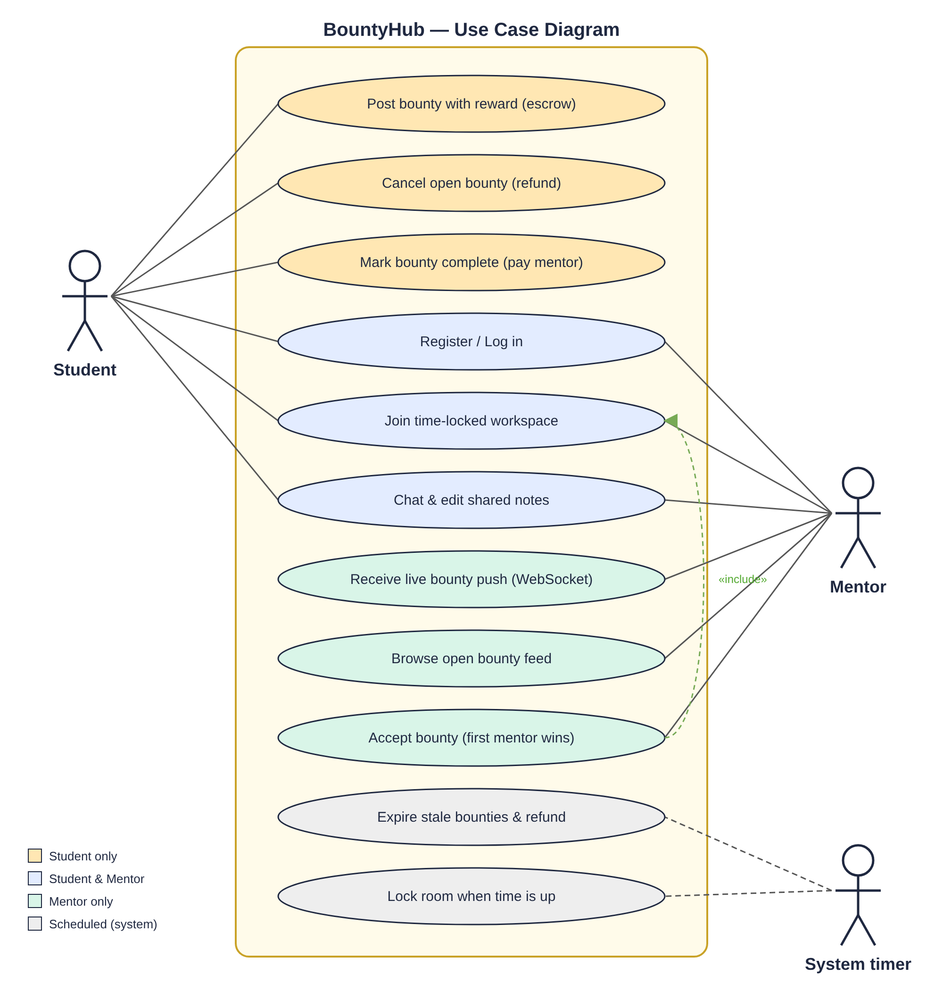

# 4. Use Cases

**Actors**

- **Student**: needs help, owns tokens, posts and pays for bounties.
- **Mentor**: has declared skills, earns tokens by solving bounties.
- **System timer**: the expiry sweeper and the room time lock.

---

### UC-01 Register / Log in
| | |
|---|---|
| Actor | Student, Mentor |
| Pre-condition | none |
| Main flow | 1. User opens the app and picks *Create account*. 2. Enters name, email, password, role (mentors also list skills). 3. System validates, hashes the password, creates the account (students get 100 tokens), returns a JWT. 4. Client stores the token and opens the WebSocket. |
| Alternate | 2a. Existing user signs in with email + password. |
| Exceptions | Invalid input → 400. Email already used → 409. Wrong credentials → 401. |
| Post-condition | Authenticated session with a live socket joined to `user:<id>` and `role:<role>`. |

### UC-02 Post a bounty
| | |
|---|---|
| Actor | Student |
| Pre-condition | Logged in as student, balance ≥ reward |
| Main flow | 1. Student fills title, details, skills needed, reward, session length, accept window. 2. System validates. 3. System **escrows** the reward. 4. System stores the bounty as `open` with an accept deadline. 5. System pushes `bounty:new` to every mentor with a matching skill. |
| Exceptions | Validation → 400. Insufficient tokens → 402 (nothing is deducted). |
| Post-condition | Bounty visible in mentor feeds; student balance reduced. |

### UC-03 Receive a live bounty push
| | |
|---|---|
| Actor | Mentor |
| Pre-condition | Mentor connected; at least one skill matches the bounty tags (or the bounty has no tags) |
| Main flow | 1. A student posts (UC-02). 2. Mentor instantly sees a toast "New bounty: …" with an **Accept** button, and a new card in *Live bounty feed*. |
| Note | Mentors without matching skills receive nothing. |

### UC-04 Browse the open bounty feed
| | |
|---|---|
| Actor | Mentor |
| Main flow | Mentor opens the dashboard; the system lists open, not-yet-expired bounties, newest first, each flagged eligible or not. Ineligible cards show a disabled "Skills don't match" button. |

### UC-05 Accept a bounty (first mentor wins)
| | |
|---|---|
| Actor | Mentor |
| Pre-condition | Bounty `open`, accept window not passed, mentor eligible |
| Main flow | 1. Mentor clicks **Accept**. 2. System atomically claims the bounty. 3. System creates a workspace room for {student, mentor} with `expiresAt = now + session length`. 4. Student receives `bounty:accepted` with a **Join room** action. 5. All mentors receive `bounty:taken` and the card disappears. 6. Mentor is redirected into the room. |
| Exceptions | Another mentor got there first or the window passed → 409 "already taken or expired". Not eligible → 403. Not a mentor → 403. |
| Post-condition | Bounty `accepted`, room `active`. |

### UC-06 Work in the time-locked workspace
| | |
|---|---|
| Actor | Student, Mentor (participants only) |
| Main flow | 1. Participant opens the room; system verifies membership and returns the room with remaining time. 2. Participants chat in real time. 3. Participants edit the shared scratchpad; changes appear live on the other side. 4. A countdown shows the remaining session time. |
| Exceptions | Non-participant → 403 (secure room). Time is up or bounty closed → 423, UI becomes read-only. |

### UC-07 Mark a bounty complete
| | |
|---|---|
| Actor | Student (poster) |
| Pre-condition | Bounty `accepted` |
| Main flow | 1. Student clicks **Mark complete & pay**. 2. System moves the bounty `accepted → completed` atomically. 3. System credits the reward to the mentor. 4. System closes the room; both sides get `room:closed`; mentor gets `bounty:completed`. |
| Exceptions | Not the poster → 403. Not in `accepted` state / already completed → 409 (no double payment). |

### UC-08 Cancel an open bounty
| | |
|---|---|
| Actor | Student (poster) |
| Main flow | Student clicks **Cancel & refund** on an open bounty; system sets `cancelled`, refunds escrow, tells mentors it's gone. |
| Exceptions | Already accepted → 409. |

### UC-09 Expire stale bounties
| | |
|---|---|
| Actor | System timer (every `EXPIRY_SWEEP_MS`, default 30 s) |
| Main flow | System finds open bounties past their accept deadline, marks each `expired`, refunds the student, notifies the student and the mentors. |

### UC-10 Lock the room when time is up
| | |
|---|---|
| Actor | System timer |
| Main flow | Once `now ≥ room.expiresAt`, every write (message or notes) is rejected with 423 and the client disables input. History stays readable to participants. |
