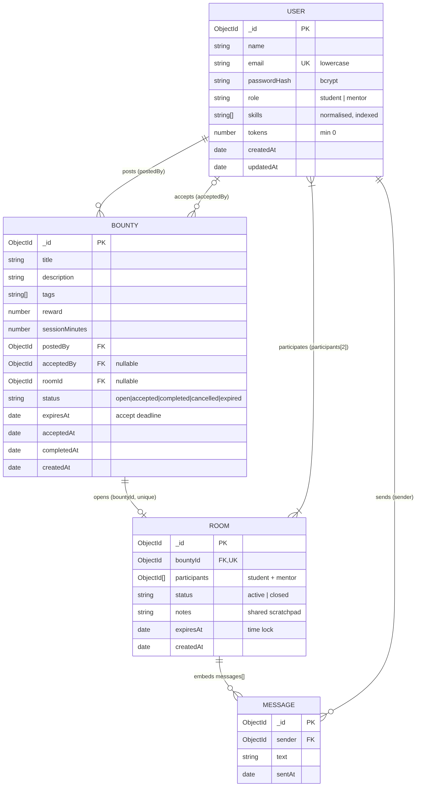

# 5. Database Design (MongoDB)

MongoDB 7 runs in Docker (`docker compose up -d mongo`). Database name: `bountyhub`. Schemas are defined with Mongoose in `server/src/repositories/mongo/models.js`.



## 5.1 Collections

### `users`
| Field | Type | Constraints / notes |
|---|---|---|
| `_id` | ObjectId | PK |
| `name` | String | required, trimmed |
| `email` | String | required, lower-case, **unique index** |
| `passwordHash` | String | bcrypt hash, never returned by the API |
| `role` | String | enum `student` \| `mentor` |
| `skills` | [String] | normalised lower-case; indexed (mentor matching) |
| `tokens` | Number | `min: 0`; changed only through guarded `$inc` |
| `createdAt`, `updatedAt` | Date | timestamps |

Indexes: `{ email: 1 }` unique, `{ skills: 1 }`, `{ role: 1, skills: 1 }`.

### `bounties`
| Field | Type | Constraints / notes |
|---|---|---|
| `_id` | ObjectId | PK |
| `title` | String | required |
| `description` | String | |
| `tags` | [String] | normalised skills required |
| `reward` | Number | ≥ 1 (escrowed tokens) |
| `sessionMinutes` | Number | length of the time lock once accepted |
| `postedBy` | ObjectId → users | required |
| `acceptedBy` | ObjectId → users | null until accepted |
| `roomId` | ObjectId → rooms | null until accepted |
| `status` | String | `open` \| `accepted` \| `completed` \| `cancelled` \| `expired` |
| `expiresAt` | Date | **accept deadline** |
| `acceptedAt`, `completedAt` | Date | |
| `createdAt`, `updatedAt` | Date | |

Indexes: `{ status: 1, expiresAt: 1 }` (feed and expiry sweep), `{ postedBy: 1, createdAt: -1 }`, `{ acceptedBy: 1, createdAt: -1 }`.

### `rooms`
| Field | Type | Constraints / notes |
|---|---|---|
| `_id` | ObjectId | PK |
| `bountyId` | ObjectId → bounties | **unique**: at most one room per bounty |
| `participants` | [ObjectId → users] | exactly `[student, mentor]` |
| `status` | String | `active` \| `closed` |
| `notes` | String | shared scratchpad |
| `messages` | [Message] | embedded sub-documents |
| `expiresAt` | Date | **time lock** |
| `createdAt`, `updatedAt` | Date | |

Embedded `Message`: `{ _id: ObjectId, sender: ObjectId → users, text: String, sentAt: Date }`.

## 5.2 Relationships

| Relationship | Cardinality | Implementation |
|---|---|---|
| User posts Bounty | 1 : N | `bounties.postedBy` |
| User accepts Bounty | 1 : N (0..1 per bounty) | `bounties.acceptedBy` |
| Bounty opens Room | 1 : 0..1 | `rooms.bountyId` (unique) + `bounties.roomId` |
| Room has participants | N : M (always 2) | `rooms.participants[]` |
| Room contains Messages | 1 : N | embedded array |

## 5.3 Why embed messages?

- A session is short (≤ 8 hours) and messages are only ever read together with their room.
- `$push` onto one document is atomic, and one read loads the whole room.
- MongoDB's 16 MB document limit is far above a realistic chat. If rooms ever became long-lived, messages would move to their own collection keyed by `roomId`.

## 5.4 Sample documents

```json
// users
{ "_id": "6720…a1", "name": "Asha", "email": "asha@nmit.ac.in", "role": "student",
  "skills": [], "tokens": 85, "passwordHash": "$2b$10$…" }

// bounties
{ "_id": "6720…b7", "title": "Debug my Docker container",
  "description": "Need someone to help me debug my Docker container in the next 2 hours.",
  "tags": ["docker"], "reward": 15, "sessionMinutes": 120,
  "postedBy": "6720…a1", "acceptedBy": "6720…c3", "roomId": "6720…d9",
  "status": "accepted", "expiresAt": "2026-10-27T10:30:00Z", "acceptedAt": "2026-10-27T10:04:12Z" }

// rooms
{ "_id": "6720…d9", "bountyId": "6720…b7", "participants": ["6720…a1", "6720…c3"],
  "status": "active", "expiresAt": "2026-10-27T12:04:12Z", "notes": "Killed: OOM\nexit code 137",
  "messages": [ { "_id": "6720…e1", "sender": "6720…c3", "text": "Run docker logs <id>", "sentAt": "…" } ] }
```

## 5.5 Atomic operations used

```js
// escrow / payout / refund: never below zero
User.findOneAndUpdate({ _id, tokens: { $gte: amount } }, { $inc: { tokens: -amount } })

// first mentor wins
Bounty.findOneAndUpdate({ _id, status: 'open', expiresAt: { $gt: now } },
                        { $set: { status: 'accepted', acceptedBy, acceptedAt: now } })

// state machine compare-and-set (complete / cancel / expire)
Bounty.findOneAndUpdate({ _id, status: fromStatus }, { $set: patch })
```

## 5.6 Inspecting the data

```bash
docker exec -it bountyhub-mongo mongosh bountyhub
> db.users.find({}, { passwordHash: 0 })
> db.bounties.find().sort({ createdAt: -1 })
> db.rooms.findOne({}, { messages: { $slice: -5 } })
```
